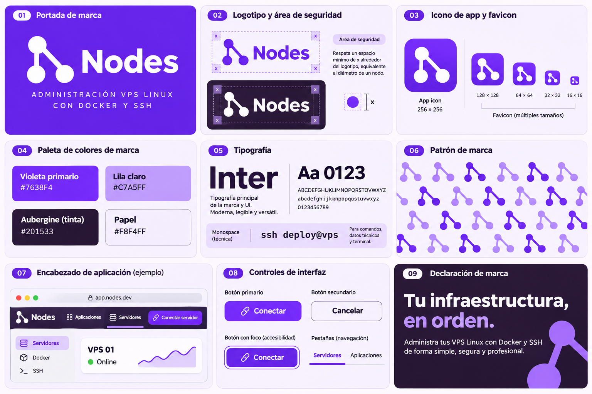

# Identidad de Nodes

La identidad principal es **03 · Violeta pulso**. El símbolo conserva tres nodos conectados: uno arriba a la izquierda, otro debajo y otro abajo a la derecha. Representa infraestructura conectada y control desde un mismo lugar.

## Archivos de marca

- [Logotipo para fondos claros](../../web/public/brand/logo.svg).
- [Logotipo para fondos oscuros](../../web/public/brand/logo-inverse.svg).
- [Símbolo independiente](../../web/public/brand/mark.svg).
- [Icono de aplicación y favicon](../../web/public/brand/icon.svg).
- [Patrón de nodos](../../web/public/brand/pattern.svg).
- [Las nueve paletas en JSON](../../web/public/brand/palettes.json).

Los SVG son archivos vectoriales editables y el tablero PNG es una referencia visual generada con ImageGen. Los valores de esta guía y los archivos de código son la especificación para implementar la marca; los textos o tonos de una imagen generada pueden variar ligeramente.

## Colores principales

| Rol | Color |
| --- | --- |
| Marca y acción | Violeta `#7638F4` |
| Acento secundario | Lila `#C7A5FF` |
| Texto y barra lateral | Berenjena `#201533` |
| Fondo | Papel `#F8F4FF` |
| Superficie | Blanco `#FFFFFF` |

Reserva el violeta vivo para acciones, selección, marca y métricas. Usa superficies claras para mantener legibles las tablas. Los enlaces y los indicadores de foco usan una variante más oscura cuando hace falta contraste. Los botones de paletas claras —cian, naranja y amarillo— usan texto oscuro. El éxito, la advertencia y el error conservan verde, ámbar y rojo, junto con etiquetas o iconos.

## Tipografía y composición

Inter es la primera opción de la familia de interfaz, con Segoe UI y fuentes del sistema como alternativas locales. No se descargan fuentes de terceros al abrir el panel. Los comandos, identificadores y datos técnicos usan tipografía monoespaciada. El wordmark utiliza una sans de peso fuerte y espaciado compacto; los SVG con texto requieren una de las fuentes declaradas para reproducirlo.

Conserva espacio libre alrededor del símbolo, equivalente al diámetro de uno de sus nodos. No añadas conexiones, no alteres sus proporciones y no uses sombras o degradados dentro del logotipo. Para fondos oscuros utiliza la versión inversa. Las tablas mantienen agrupación mediante espacio y divisores; los colores intensos no rellenan grandes áreas de datos.

## Cambiar de paleta

En **Apariencia**, disponible en la barra lateral y en el acceso al panel, elige una de las nueve opciones. Se aplica inmediatamente y se recuerda en este navegador. No cambia el PIN, las credenciales, los servidores ni la configuración remota.

| Opción | Color principal | Secundario |
| --- | --- | --- |
| 01 · Azul eléctrico | `#245BFF` | `#77C8FF` |
| 02 · Naranja solar | `#FF6828` | `#FFC66E` |
| 03 · Violeta pulso | `#7638F4` | `#C7A5FF` |
| 04 · Cian digital | `#04C5EC` | `#73E8FF` |
| 05 · Coral activo | `#FF4E63` | `#FFB4A7` |
| 06 · Índigo ultravioleta | `#4B46FF` | `#AA9CFF` |
| 07 · Amarillo voltio | `#FFD234` | `#FFF0A3` |
| 08 · Fucsia señal | `#E83D9B` | `#FFACD4` |
| 09 · Azul + mandarina | `#2862EF` | `#FF963B` |

Las paletas están declaradas en `web/src/lib/themes.js`. De ellas se derivan los roles de fondo, texto, superficie, acción, foco, selección, gráficas y terminal. La preferencia se guarda en `nodes.appearance.v1`; una selección desconocida vuelve a Violeta pulso. El favicon y los archivos descargables representan la identidad violeta principal.

## Brief del tablero

Generado con la herramienta integrada ImageGen y las habilidades imagegen y brandkit. Prompt de dirección: desarrollar el branding de Nodes con la opción 03 Violeta pulso, conservar el símbolo exacto de tres nodos, y mostrar logotipo, variantes sobre fondos claros/oscuros, área de seguridad, icono, favicon, paleta, tipografía, patrón, encabezado de aplicación y controles. Estilo profesional, legible, violeta vivo, superficies claras y contraste berenjena.
